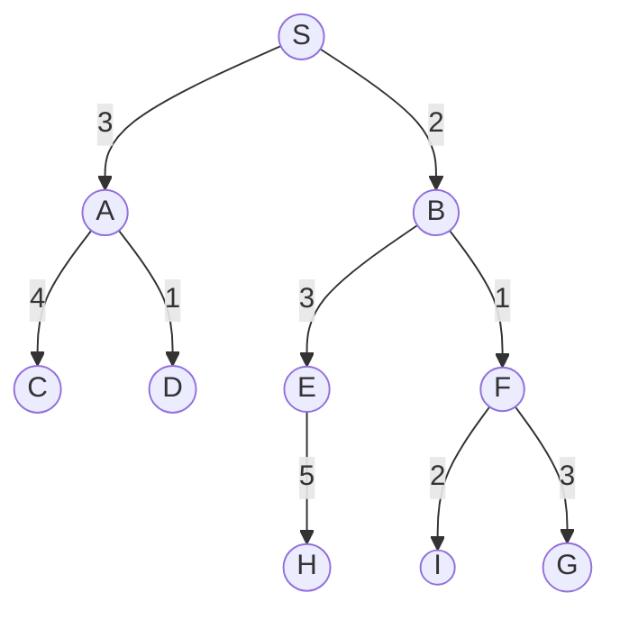
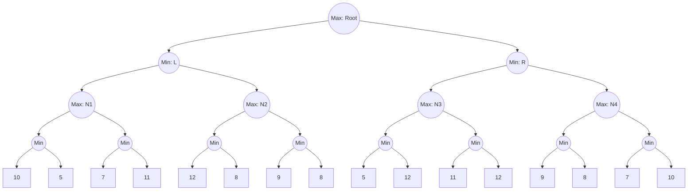
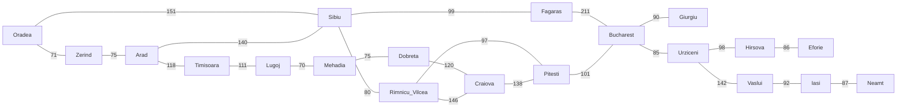
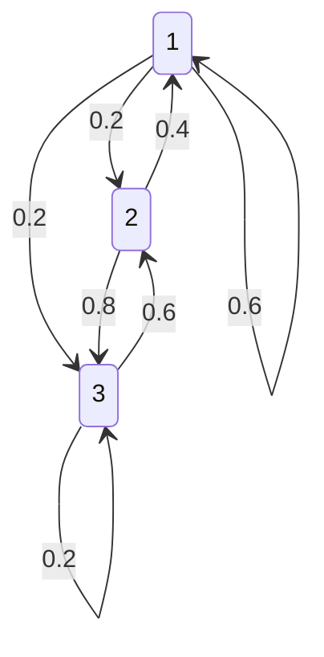
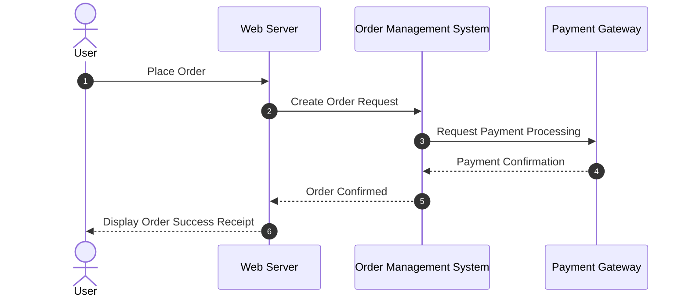

# University of Dhaka - Affiliated Engineering Colleges
## 4th Year 1st Semester B.Sc. Engg. Examination 2023
### Complete Question Bank (Verbatim Extraction)

---

## 1. CSE 4101: Artificial Intelligence
* **Full Marks:** 70 (3.0 Credits)
* **Time:** 3 Hours
* **Instructions:** Answer any five (5) of the following questions. Answers should not be fragmented and be written as sequentially as possible. All the symbols have their usual meanings. Assume standard values for any missing data.

---

### Question 1
(a) Write down the goals of Artificial Intelligence. **[1]**  
(b) Differentiate between strong AI and weak AI. **[2]**  
(c) Give a PEAS description of the following task environment and characterize it in terms of task environment. **[9]**  
    I. Automated taxi driver  
    II. Vacuum cleaner  
    III. Backgammon  
(d) Briefly describe about Turing Test. **[2]**

---

### Question 2
(a) Write down the difference between informed and uninformed search. **[4]**  
(b) What is LCV and MRV in CSP for improving Backtracking? Explain with example. **[4]**  
(c) Given an initial state of 8 puzzle problem and final state to be reached. **[6]**

**Initial State:**
| 2 | 5 | 4 |
|---|---|---|
| 1 | 6 | 8 |
| 3 |   | 7 |

**Final State:**
| 1 | 2 | 3 |
|---|---|---|
| 8 |   | 4 |
| 7 | 6 | 5 |

Find the most cost effective path to reach the final state from initial state using A* search algorithm.

---

### Question 3
(a) Write the disadvantage of Hill-climbing search. **[3]**  
(b) Explore the following graph from the source node (S) the destination node (G) using A* search. **[5]**

**Heuristic Values $h(n)$:**
| Node | $h(n)$ |
|:---:|:---:|
| **S** | 13 |
| **A** | 12 |
| **B** | 4 |
| **C** | 7 |
| **D** | 3 |
| **E** | 8 |
| **F** | 2 |
| **H** | 4 |
| **I** | 9 |
| **G** | 0 |

**Search Graph (Mermaid):**

(c) What is heuristic function? Explain. **[2]**  
(d) Proof that if $h(n)$ is consistent, A* using GRAPH-SEARCH is optimal. **[4]**

---

### Question 4
(a) What is limitation of Min-max algorithm? Write down the properties of Min-max algorithm. **[4]**  
(b) Explore the following graph of figure 2 using Alpha-beta pruning. **[5]**

**Alpha-Beta Pruning Game Tree:**

*Leaf Values (from left to right):* `[10, 5], [7, 11], [12, 8], [9, 8], [5, 12], [11, 12], [9, 8], [7, 10]`

(c) What is Adversarial Search? Explain Genetic algorithm with example. **[5]**

---

### Question 5
(a) What are the three components of Constraint Satisfaction Problem? Give an example. **[3]**  
(b) Describe steps of Genetic algorithm (e.g. Selection, Crossover, Mutation and Fitness) with proper example. **[7]**  
(c) What is Ontology in Knowledge Representation? **[2]**  
(d) Write down the difference between game and search problem. **[2]**

---

### Question 6
(a) Briefly describe the logical Connectives of Propositional Logic **[5]**  
(b) Convert the following English statement into FOL **[5]**  
    (i) Every man respects his parent  
    (ii) There is somebody whom everybody loves  
    (iii) Some student has never been asked a question by a faculty member  
    (iv) Sumy has never sent an e-mail message to Kona  
    (v) Some boys play cricket  
(c) Define Inference and Existential Quantifiers in FOL with example? **[4]**

---

### Question 7
(a) What is Natural language Processing (NLP)? Explain Phases of NLP. **[4]**  
(b) How to build an NLP pipeline? **[4]**  
(c) Differentiate between informed and uninformed search. **[2]**  
(d) Using Greedy best-first search find the cost and show the steps from the source Arad to the destination Bucharest. **[4]**

**Map of Romania (Road Distances between Cities):**

---
---

## 2. CSE 4102: Mathematical and Statistical Analysis for Engineers
* **Full Marks:** 70 (3.0 Credits)
* **Time:** 3 Hours
* **Instructions:** Answer any five (5) of the following questions. Answers should not be fragmented and be written as sequentially as possible. All the symbols have their usual meanings. Assume standard values for any missing data.

---

### Question 1
(a) What is a bivariate graph? List some bivariate graphs with proper examples. **[2]**  
(b) What is Cross-correlation? Write the difference between covariance and correlation. **[3]**  
(c) Let us consider a null hypothesis- A man is not guilty of a crime. Now, according to above hypothesis write the statement for Type I error and Type II error. Is a Type I or Type II error worse? **[3]**  
(d) Multiple Linear Regression is a powerful tool for understanding relationships in data and making predictions. Suppose we want to predict the price of a house based on the following independent variables: Square Footage (in thousands), Number of Bedrooms, Age of the House (in years). Now write the necessary steps with formula for Predicting House Prices. **[3]**  
(e) Calculate the coefficient of covariance for the following data: **[3]**  

| X | 2 | 8 | 18 | 20 | 28 | 30 |
|---|---|---|----|----|----|----|
| Y | 5 | 12 | 18 | 23 | 45 | 50 |

---

### Question 2
(a) Why is Laplace Transformation important for engineering? Perform the Laplace Transform of function $F(t) = e^{-2t}(3\cos 6t - 5\sin 6t)$ **[3]**  
(b) Find Laplace Transform for the following function using the Table of Laplace Transforms $F(t) = [t(3\sin 2t - 2\cos 2t)]$ **[3]**  
(c) Perform the inverse Laplace transform of the following expression: **[4]**  
$$F(s) = \frac{P(s)}{Q(s)} = \frac{S+2}{S^2 - 4S + 13}$$  
(d) Use Laplace transformation to solve the following initial value problem: **[4]**  
$$y'' - y' - 2y = 0; \quad y(0) = 1; \quad y'(0) = 2$$

---

### Question 3
(a) What is Stochastic Process? Write about the applications of stochastic processes. **[3]**  
(b) Define the birth and death process stochastic process? Draw a scatter plot correlation for strong positive correlation, strong negative correlation, weak negative correlation, and no correlation. **[3]**  
(c) What is statistical inference? Explain fundamental concepts in statistical inference. **[4]**  
(d) What is meant by stationary process? Describe with formula First Order Stationary Process and Second Order Stationary Process. **[4]**

---

### Question 4
(a) What is Little's law formula? Describe the features of M/M/1/K Queue model. **[3]**  
(b) In a municipality hospital patients arrival are considered to be Poisson with an arrival interval time of 10 mins. The doctors (examination and dispensing) time may be assumed to be ED with an average of 6 mins. Now find: **[5]**  
    i) What is the chance that a new patient directly sees the doctor?  
    ii) For what proportion of the time the doctor is busy?  
    iii) What is the average number of patients in the system?  
    iv) What is the average waiting time of the system?  
    v) Suppose the municipality wants to recruit another doctor, when an average waiting time of an arrival is 30 mins in the queue. Find out how large should be to justify a 2nd doctor?  
(c) In the classic Gambler's Ruin problem, a gambler starts with an initial fortune of $i$ dollars and on each game, the gambler wins $\$1$ with probability $p$ or loses $\$1$ with probability $q = 1 - p$, where $0 \le p \le 1$. The gambler will stop playing if either $N$ dollars are accumulated or all money has been lost. Now find: **[6]**  
    i) John starts with $\$2$, and $p = 0.6$. What is the probability that John obtains a fortune of $N = 4$ without going broke?  
    ii) What is the probability that John will become infinitely rich?  
    iii) If John instead started with $i = \$1$, what is the probability that he would go broke?

---

### Question 5
(a) What do you mean by linear optimization? What is the use of optimization in Computer Science? **[3]**  
(b) Define Z-score. A person wants some belts and wallets. He has total savings of Tk 6500 and wishes to spend all his savings on purchasing belts and wallets so that he can sell it later. The value of the wallet is Tk 25 and the value of the belt is Tk 15. He wants to store them in a cupboard and the maximum capacity of the cupboard is 50 units. He expects a profit of Tk 2.5 on the belt and Tk 3 on the wallet. Find the constraints and the resulting objective function. **[3]**  
(c) What is a Sensitivity Analysis? Write Sensitivity Analysis Tools and Techniques. **[3]**  
(d) Convert Primal to the dual of the given problem. **[5]**  
$$\text{Max } Z = x_1 + 2x_2 + x_3$$  
$$\text{Subject to}$$  
$$2x_1 + x_2 - x_3 \le 2$$  
$$-2x_1 + x_2 - 5x_3 \ge -6$$  
$$4x_1 + x_2 + x_3 \le 6$$  
$$x_1, x_2, x_3 \ge 0$$

---

### Question 6
(a) Why do we use Fourier transform? Perform the Fourier transform of function find: **[4]**  
$$F\left\{\frac{1}{2}\left[H\left(t + \frac{1}{2}\right) - H\left(t - \frac{1}{2}\right)\right]\right\} = ?$$  
$$\text{Where } F\{H(t)\} = F(\omega) = \frac{2i}{\omega}$$  
(b) Find Fourier Cosine transform of: **[5]**  
$$f(x) = \begin{cases} x, & 0 < x < 1 \\ 2 - x, & 1 < x < 2 \\ 0, & x > 2 \end{cases}$$  
(c) Parseval's identity ensures energy conservation, relating time and frequency domain representations of signals. Using Parseval's identity if: **[5]**  
$$f(x) = \begin{cases} 1 & x < |a| \\ 0 & x > |a| \end{cases} \quad \text{and} \quad f(s) = \sqrt{\frac{2}{\pi}} \frac{\sin sa}{s}$$  
$$\text{now find that } \int_0^\infty \left(\frac{\sin^2 x}{x^2}\right) dx = ?$$

---

### Question 7
(a) Eigenvalues and eigenvectors provide insights into linear transformations, system stability, and dimensionality reduction in data analysis. Find all the Eigenvalues and Eigenvectors of the matrix: **[5]**  
$$\begin{bmatrix} 1 & -1 & 4 \\ 3 & 2 & -1 \\ 2 & 1 & -1 \end{bmatrix}$$  
(b) Purpose-flea zooms around the vertices of the transition diagram opposite. Let $X_t$ be Purpose-flea's state at time $t$ ($t = 0, 1, \dots$). **[5]**

**Transition State Diagram (Mermaid):**

i) Find the transition matrix, P.  
ii) Find $P(X_2 = 3 \mid X_0 = 1)$.  
iii) Suppose that Purpose-flea is equally likely to start on any vertex at time 0. Find the probability distribution of $X_1$.  
iv) Suppose that Purpose-flea begins at vertex 1 at time 0. Find the probability distribution of $X_2$.  
v) Suppose that Purpose-flea is equally likely to start on any vertex at time 0. Find the probability of obtaining the trajectory $(3, 2, 1, 1, 3)$.  

(c) Glee-flea hops around on a triangle. At each step he moves to one of the other two vertices at random. What is the expected time taken for Glee-flea to get from vertex 1 to vertex 2? **[4]**

---
---

## 3. SS 4103: Entrepreneurship for IT Business
* **Full Marks:** 70 (2.0 Credits)
* **Time:** 3 Hours
* **Instructions:** Answer any five (5) of the following questions. Answers should not be fragmented and be written as sequentially as possible. All the symbols have their usual meanings. Assume standard values for any missing data.

---

### Question 1
(a) Who are the entrepreneurs? Write five functions of an entrepreneur. **[5]**  
(b) What are the benefits of entrepreneurship for individual? **[3]**  
(c) Describe the roles of entrepreneurship in economic development. **[6]**

---

### Question 2
(a) How Creativity and Innovation is interconnected with each other? Expalin. **[4]**  
(b) How are to enhance creativity? Briefly describe. **[6]**  
(c) What are the steps of creative process? **[4]**

---

### Question 3
(a) What is feasibility study? **[3]**  
(b) What are the Key components of a Business Strategic Plan? How to develop a Strategic Plan. **[7]**  
(c) Explain the following terms: i. Secondary research; ii. Prototype **[4]**

---

### Question 4
(a) What are the steps of strategic management process? Very shortly describe each step. **[10]**  
(b) What are the three V's approaches of marketing? Write down the core business processes of marketing. **[4]**

---

### Question 5
(a) What are the key concerns in ethical entrepreneurship? **[5]**  
(b) Show the Holistic Marketing Framework with diagram. **[5]**  
(c) What are the basic features of ethics? **[4]**

---

### Question 6
(a) Define financial planning. Explore different types of financial planning. **[5]**  
(b) Describe the methods of financing your business. **[5]**  
(c) Compare between equity financing and debt financing. **[4]**

---

### Question 7
(a) Explain operations management. State some functions of operations management. **[5]**  
(b) Define operating scheduling. Describe the objectives of the operations scheduling. **[4]**  
(c) What is plant capacity? What are the factors affecting determination of plant capacity? **[5]**

---
---

## 4. CSE 4125: Introduction to Machine Learning
* **Full Marks:** 70 (3.0 Credits)
* **Time:** 3 Hours
* **Instructions:** Answer any five (5) of the following questions. Answers should not be fragmented and be written as sequentially as possible. All the symbols have their usual meanings. Assume standard values for any missing data.

---

### Question 1
(a) What do you mean by machine learning? **[2]**  
(b) Differentiate among machine learning, deep learning and artificial intelligence. **[5]**  
(c) Describe about the different data processing steps. **[5]**  
(d) What is bias and variance? **[2]**

---

### Question 2
(a) Define logistic regression. How can logistic regression be extended or adapted for multiclass classification problems? **[3]**  
(b) What are some common linkage criteria used in hierarchical clustering? How do you determine the optimal number of clusters in k-means clustering? **[5]**  
(c) Explain the concept of sigmoid function. Let's say you have a dataset with 6 points in a 2D space : A(1,2), B(1,4), C(1,0), D(4,2), E(4,4), F(4,0). Imagine you cluster these points into two clusters : Cluster 1 : A, B, C and Cluster 2 : D, E, F. Calculate the Within-Cluster Sum of Squares (WCSS) for this clustering. **[6]**

---

### Question 3
(a) Assume a classification problem for 14 random data points. Calculate the binary cross entropy.  
$x = [-2.2, -1.6, -1.4, -1.2, -0.8, 0.2, 0.4, 0.8, 1.2, 1.4, 2.2, 2.9, 3.2, 4.6]$ **[5]**  
(b) What is confusion matrix and ROC curve? **[2]**  
(c) Explain the support vector machine (SVM) algorithm for binary classification. **[4]**  
(d) Explain the concept of feature extraction and how it differs from feature selection. **[3]**

---

### Question 4
(a) What is curse of dimensionality? Explain principal component analysis (PCA) and how it helps in dimensionality reduction. **[3]**  
(b) Define entropy and information gain. Explain how decision tree works. **[5]**  
(c) Explain the concept of stratified k-fold cross-validation. Why is it preferred in classification tasks, especially when dealing with imbalanced datasets? **[3]**  
(d) Define and differentiate between precision, recall, and F1 score. **[3]**

---

### Question 5
(a) Define the Expectation Maximization Algorithm. Discuss convergence properties of the Expectation Maximization Algorithm. **[3]**  
(b) Define imbalanced dataset. Explain any two techniques to handle imbalanced dataset. **[3]**  
(c) What is markov property? Consider a Markov model with three states Sunny, Rainy, and Cloudy. The transition probability matrix is given by: **[5]**

| | Sunny | Rainy | Cloudy |
|---|---|---|---|
| **Sunny** | 0.8 | 0.15 | 0.05 |
| **Rainy** | 0.38 | 0.6 | 0.02 |
| **Cloudy** | 0.75 | 0.05 | 0.3 |

Given that, the weather is Sunny today. What is the probability that tomorrow is Sunny and day after tomorrow is Rainy?  
(d) Define feature engineering and explain its importance in machine learning. **[3]**

---

### Question 6
(a) Define feature engineering and explain its importance in machine learning. **[3]**  
(b) Describe about the working procedure of principal component analysis. **[6]**  
(c) Explain about the expectation maximization algorithm. **[5]**

---

### Question 7
(a) Discuss details about probability density function. **[6]**  
(b) Using k-nearest neighbors algorithm find the class(?) where $k = 5$. **[8]**

**Training Set:**
| Brightness | Saturation | Class |
|:---:|:---:|:---:|
| 40 | 20 | Red |
| 50 | 50 | Blue |
| 60 | 90 | Blue |
| 10 | 25 | Red |
| 70 | 70 | Blue |
| 60 | 10 | Red |
| 25 | 80 | Blue |

**Query Point:**
| Brightness | Saturation | Class |
|:---:|:---:|:---:|
| 20 | 35 | ? |

---
---

## 5. CSE 4126: Introduction to Data Science
* **Full Marks:** 70 (3.0 Credits)
* **Time:** 3 Hours
* **Instructions:** Answer any five (5) of the following questions. Answers should not be fragmented and be written as sequentially as possible. All the symbols have their usual meanings. Assume standard values for any missing data.

---

### Question 1
(a) Define Data Science? Mention the key difference between Qualitative data and Quantitative data. **[4]**  
(b) Suppose, you own a software company. You need to collect data whether your customers are satisfied with your product or not. Which method will you apply to collect data? Explain the reasons behind choosing this method? **[4]**  
(c) Breifly describe some common challenges in data collection. **[6]**

---

### Question 2
(a) Mention the reasons why data missing occured in a data set? **[2]**  
(b) Explain KNN Imputation technique with an example to estimate the missing value from a data set. **[5]**  
(c) What is data binning? Explain the suitable binning method to reduce noise, considering the following data: 10, 15, 22, 27, 30, 30, 36, 42, 50. **[5]**  
(d) Write short note on the parameters of population. **[2]**

---

### Question 3
(a) What is an outlier data in a data set? Suppose, we have a data set on a subject marks out of 100 for 10 students as follows: 50, 55, 40, 62, 10, 33, 85, 77, 28, 82. Identify the marks are significantly different from others, which may indicate anomaly or outlier data. (Use Z-score based outlier detection technique to solve this). **[7]**  
(b) Define data integration. What are the key aspects of data integration in data mining? **[3]**  
(c) How to calculate corelation analysis to detect redundant attributes? Explain with example. **[4]**

---

### Question 4
(a) What is Regression Line? Explain Positive and Negative Linear Relationship. **[4]**  
(b) Distinguish between Linear Regression and Logistic Regression. **[4]**  
(c) Write short note on log-linear models. **[3]**  
(d) What is histogram? Why histogram analysis is important? **[3]**

---

### Question 5
(a) What Is Correlation? Explain different types of correlation with figure. **[4]**  
(b) Find and calculate the correlation coefficient of the following table: **[6]**

| Subject | Age(X) | Weight(Y) |
|:---:|:---:|:---:|
| 1 | 40 | 99 |
| 2 | 25 | 79 |
| 3 | 22 | 69 |
| 4 | 54 | 89 |

(c) Distinguish between SQL and NoSQL. **[2]**  
(d) Identify the key differences between quantitative and qualitative data. **[2]**

---

### Question 6
(a) What is Exploratory Data Analysis? Why is it important? **[3]**  
(b) Describe various types of EDA techniques. **[4]**  
(c) Explain Concept Hierarchy generation. **[3]**  
(d) What is data modeling? Write a comparative study among Conceptual, Logical, and Physical data model. **[4]**

---

### Question 7
(a) Briefly describe data sampling techniques. **[6]**  
(b) Explain regression analysis and show the axis value on a graph/chart. **[4]**  
(c) Explain how to handle redundancy in data integration. **[4]**

---
---

## 6. CSE 4128: Wireless Networks
* **Full Marks:** 70 (3.0 Credits)
* **Time:** 3 Hours
* **Instructions:** Answer any five (5) of the following questions. Answers should not be fragmented and be written as sequentially as possible. All the symbols have their usual meanings. Assume standard values for any missing data.

---

### Question 1
(a) Why wireless medium is called unguided medium? Explain the significance of frequency spectrum in wireless communication. **[5]**  
(b) Differentiate between Cellular and Mobile Ad-hoc networks. **[5]**  
(c) A cellular network has a cell radius of 1.5 km, and each cell serves 200 users on average. If the total area covered by the network is 300 km², calculate the approximate number of cells required and the total number of users supported by the network. **[4]**

---

### Question 2
(a) Explain the concept of radio propagation and its effect on wireless communication. How do factors like fading and interference impact signal quality? **[5]**  
(b) Compare and contrast between CDMA and OFDM in case of handling interference and bandwidth efficiency. **[5]**  
(c) A wireless communication system operates at a frequency of 2.4 GHz. Calculate the free space path loss (in dB) if the transmitter and receiver are 5 km apart. **[4]**

---

### Question 3
(a) Depict the architecture of a sensor network. List down some common applications of it. **[5]**  
(b) State the framework of a wireless mesh network. How does it differ from traditional networks? **[5]**  
(c) In a sensor network, each node has an initial battery of 2000 mAh and consumes 10 mA during active communication. If the duty cycle of a node is 10%, calculate the expected lifetime of a sensor node. **[4]**

---

### Question 4
(a) Identify the efficiency of Aloha and Slotted Aloha for channel utilization and collision probability. **[5]**  
(b) Discuss the role of power control in wireless networks. Why is it important in both fixed-rate and rate-adaptive systems? **[5]**  
(c) A TDMA-based system has a total bandwidth of 20 MHz and supports 100 users. If each user is allocated an equal time slot, calculate the data rate per user. **[4]**

---

### Question 5
(a) Demonstrate the key mechanisms that is used to detect and mitigate network congestion. **[5]**  
(b) Illustrate the concept of utility optimization of congestion control and its significance in wireless communication. **[5]**  
(c) In a wireless TCP connection, the round-trip time (RTT) is 100 ms, and the congestion window size is 20 segments (each segment is 1 KB). Calculate the throughput of the connection. **[4]**

---

### Question 6
(a) What is ALOHA in networking? **[2]**  
(b) Discuss the role of Medium Access Control (MAC) protocol in wireless communication networks with an example. **[4]**  
(c) Write the key differences between TDMA and FDMA. **[3]**  
(d) Define CSMA. Briefly explain the importance of Resource allocation in a network with a dynamic user population. **[5]**

---

### Question 7
(a) What do you mean by Network Routing? **[2]**  
(b) Write a brief discussion on working principle of MANET's AODV reactive routing protocol. **[4]**  
(c) Discuss the concept of network planning and optimization in wireless cellular networks. **[3]**  
(d) Differentiate between backpressure Routing and opportunistic Routing. **[5]**

---
---

## 7. CSE 4135: Software Requirements Specification and Analysis
* **Full Marks:** 70 (3.0 Credits)
* **Time:** 3 Hours
* **Instructions:** Answer any five (5) of the following questions. Answers should not be fragmented and be written as sequentially as possible. All the symbols have their usual meanings. Assume standard values for any missing data.

---

### Question 1
(a) Write short notes on software process. List down its activities. **[1+2]**  
(b) Compare and contrast between the Software and System Engineering. **[4]**  
(c) Explain UML in case of Robotic Arm with proper sequence diagram. **[7]**

---

### Question 2
(a) Describe requirement engineering. Why is it called "Extreme" in extreme programming? **[1+2]**  
(b) If you have to develop word processing software, what process models will you choose if the requirements are available? Justify your answer. **[5]**  
(c) Write down the principles of Agile methods along with its challenges. **[6]**

---

### Question 3
(a) Discuss about SDLC in terms of software development. **[6]**  
(b) Depict and describe scrum sprint cycle briefly. **[4]**  
(c) Distinguish between Data and Control flow model. **[4]**

---

### Question 4
(a) Briefly describe flow oriented modeling. **[4]**  
(b) What is SRS? Explain in detail about various components of an SRS. **[1+6]**  
(c) Describe the concept of Process Activation Table (PAT). **[3]**

---

### Question 5
(a) Define ethnography. Write down the scope of ethnography. **[4]**  
(b) Explain the guidelines for writing requirements. **[3]**  
(c) Draw and briefly explain the spiral view of requirement engineering process. **[7]**

---

### Question 6
(a) Explain the Agile Methodology for Software Requirement Analysis and how it differs from traditional methods. **[5]**  
(b) Discuss the concept of Requirement Prioritization and describe various techniques used to prioritize requirements. **[5]**  
(c) Explain the importance of UML (Unified Modeling Language) in Software Requirement Analysis and describe its role in creating diagrams for system specifications. **[4]**

---

### Question 7
(a) Define sequence diagram. Create a Sequence Diagram for a simple order processing system in an e-commerce application. Show the interactions between the user, web server, order management system, and payment gateway. **[8]**

**Sequence Diagram Representation (Mermaid):**

(b) Explain the implementation phase in SDLC. Discuss the role of coding standards and code reviews in ensuring the quality of the software. **[6]**
