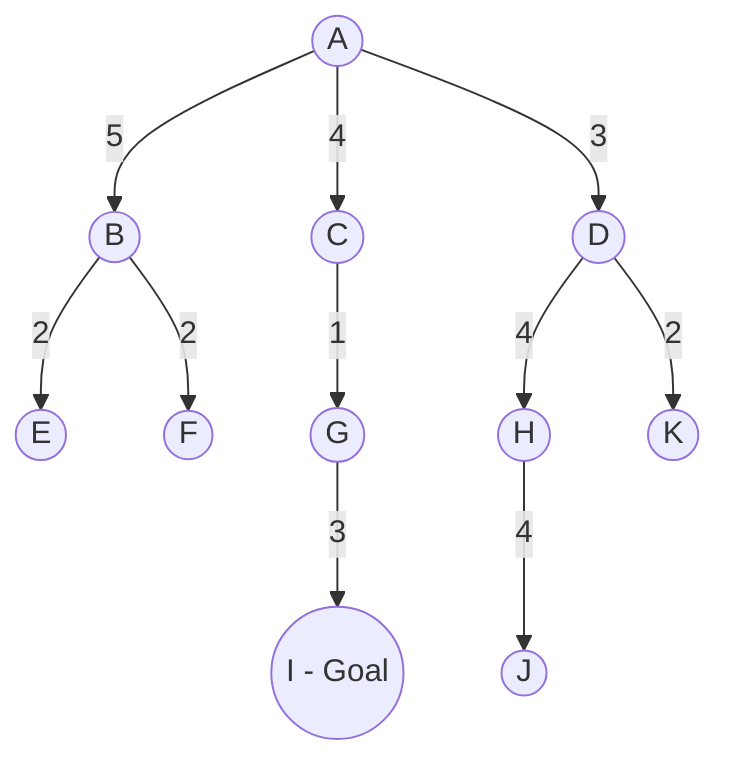
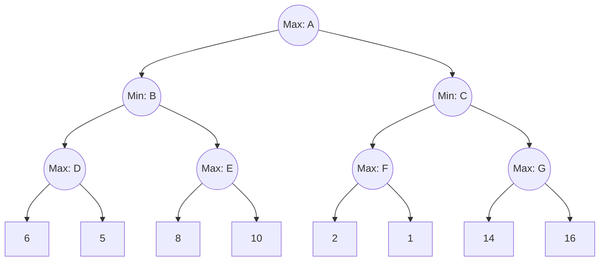
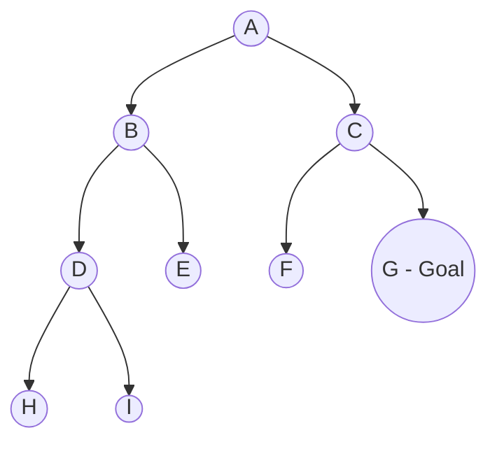

# University of Dhaka - Affiliated Engineering Colleges
## 4th Year 1st Semester B.Sc. Engg. Examination 2024
### Complete Question Bank (Verbatim Extraction)

---

## 1. CSE-4101: Artificial Intelligence
* **Full Marks:** 70
* **Time:** 3 Hours
* **Instructions:** Answer any 5 (Five) of the following Questions.

---

### Question 1
(a) Define Artificial Intelligence. List five problems that cannot be currently aided/solved by AI. **[4]**  
(b) Give a PEAS description of the following task environment and characterize it in terms of task environment. **[4]**  
    i. Automated taxi driver  
    ii. Vacuum cleaner  
(c) For the following tree, show the order of nodes visited for i) breadth-first search, ii) depth-first search, iii) uniform cost search, and iv) iterative deepening search. The goal node is I and the numbers next to the edges indicate the associated cost. **[6]**

**Search Tree (Mermaid):**


---

### Question 2
(a) Define Genetic Algorithm and its working principles with a suitable example. **[3]**  
(b) How is a two-player game formulated as a search problem? Explain the roles of terminal test and utility function. **[4]**  
(c) Explain the Adversarial Search algorithm with an example game tree. **[3]**  
(d) Describe Greedy Best-First Search. Why is it not guaranteed to produce an optimal solution? **[4]**

---

### Question 3
(a) Explain details about how heuristic functions guide the search process toward the goal. **[4]**  
(b) Write down the strategies to improve Backtracking in Constraint Satisfaction Problem? Explain with example. **[4]**  
(c) Describe the Decision Tree learning algorithm. Explain with proper mathematical example how attribute selection is performed using: i) Information Gain and ii) Gini Index. **[6]**

---

### Question 4
(a) Explain the components of the A* evaluation function $f(n) = g(n) + h(n)$. Write down the application of A* search. **[4]**  
(b) Convert the following English statement into FOL: **[5]**  
    i. Every man respects his parent  
    ii. There is somebody whom everybody loves  
    iii. Not all students like both Mathematics and Science  
    iv. Mahmud has never sent an e-mail message to Abdullah  
    v. Everybody loves somebody  
(c) Write short note on two types of quantifiers in FOL with example? **[3]**  
(d) Write down the application of AI in robotics. **[2]**

---

### Question 5
(a) Given the following search tree, apply the alpha-beta pruning algorithm and show the search tree that would be obtained. Make sure that you show where the cuts are applied and which parts of the search tree are pruned as a result. **[5]**

**Search Tree for Alpha-Beta Pruning:**


(b) What is Reinforcement Learning? Differentiate between Supervised and Unsupervised machine learning. **[4]**  
(c) Write short note on Neural networks. **[5]**

---

### Question 6
(a) A disease affects 1% of the population. A test is 95% accurate for both positive and negative results. If a person tests positive, what's the probability they have the disease? **[4]**  
(b) Write down the equation for Conditional Probability and Bayes Theorem. **[3]**  
(c) Consider a single neuron with the following parameters: **[7]**  
$$\text{Inputs: } x_1 = 1.0, \; x_2 = 0.5$$  
$$\text{Weights: } w_1 = 0.4, \; w_2 = -0.6$$  
$$\text{Bias: } b = 0.1$$  
$$\text{Activation function: Sigmoid}$$  
$$\text{Target output: } t = 1$$  
$$\text{Learning rate: } \eta = 0.2$$  

Now,  
a) Compute the **net input** and the **output of the neuron**.  
b) Calculate the **error** using Mean Squared Error (MSE).  
c) Using **backpropagation**, compute the **weight and bias updates** for one training step.

---

### Question 7
(a) Write down the Limitation of Hill Climbing Search with explanation? **[4]**  
(b) Which heuristics are admissible for the 8-puzzle problem and why? **[4]**  
(c) Perform Iterative Deepening Search based on the following graph to reach goal node G. **[4]**

**Graph Structure (Mermaid):**


(d) What is an ontology? How does it differ from a taxonomy or a database schema? **[2]**

---
---

## 2. CSE-4102: Mathematical and Statistical Analysis for Engineers
* **Full Marks:** 70
* **Time:** 3 Hours
* **Instructions:** Answer any 5 (Five) of the following Questions.

---

### Question 1
(a) A smart phone app tracks: Battery usage time (hours) and Screen brightness level (0-100 scale). Which variable is ratio-scaled and which is not? Justify. **[3]**  
(b) A medical test is designed to detect a serious disease. **[3]**  
    i. What is a Type I error in this context?  
    ii. What is a Type II error in this context?  
    iii. Which error is more dangerous and why?  
(c) A city uses a linear model to predict traffic congestion based on number of vehicles, Time of day, Weather conditions. After deployment, predictions are poor during festivals, which linear model assumptions are likely violated, and why? **[4]**  
(d) The table below shows daily temperature (X) and ice-cream sales (Y). **[4]**

| X | 18 | 20 | 22 | 24 | 26 |
|---|----|----|----|----|----|
| Y | 50 | 65 | 80 | 95 | 110 |

i. Calculate the coefficient of covariance.  
ii. Explain what the value indicates about their relationship.

---

### Question 2
(a) If $\{f(t)\} = \bar{F}(s)$ then prove that $\mathcal{L}\{u(t-a)f(t-a)\} = e^{-as}\bar{F}(s)$. **[4]**  
(b) Use Laplace transformation to solve the equation: **[4]**  
$$(D^3 - 3D^2 + 3D - 1)Y = t^2 e^t \quad \text{given that } Y(0) = 1, \; Y'(0) = 0, \; Y''(0) = -2$$  
(c) Perform the inverse Laplace transform of the following expression: **[4]**  
$$\log\left\{\left(1 + \frac{1}{s^2}\right)^\frac{1}{2}\right\}$$  
(d) Define sampling distribution. What happens to the sampling distribution of the mean as sample size increases? **[2]**

---

### Question 3
(a) Explain how Fourier Transform is used in filter design and frequency analysis of signals. **[2]**  
(b) Perform the Fourier transform of function find $f(x) = e^{-ax^2}$ where $a > 0$. **[4]**  
(c) Find Fourier Cosine transform of: **[4]**  
$$f(x) = \begin{cases} x, & 0 < x < 1 \\ 2 - x, & 1 < x < 2 \\ 0, & x > 2 \end{cases}$$  
(d) Parseval's identity ensures energy conservation, relating time and frequency domain representations of signals. Using Perseval's identity if: **[4]**  
$$f(x) = \begin{cases} 1 & x < |a| \\ 0 & x > |a| \end{cases} \quad \text{and} \quad f(s) = \sqrt{\frac{2}{\pi}} \frac{\sin sa}{s}$$  
$$\text{now find that } \int_0^\infty \left(\frac{\sin^2 x}{x^2}\right) dx = ?$$

---

### Question 4
(a) Explain Poisson process and Exponential process with applications. **[4]**  
(b) Suppose that customers arrive at a bank according to a poisson process with mean rate of 3 per minute. Find the probability during the time interval of 2 minute: **[4]**  
    I. Exactly 4 customers arrive  
    II. More than 4 customers arrive  
(c) Three boys A, B and C are throwing a ball to each other. A always throws the ball to B and B always throws the ball to C, but C is as likely to throw the ball to B as to A. If the initial probability distribution of three states A, B, C is 0.3, 0.4 and 0.3 respectively, Find: **[6]**  
    I. The transition matrix.  
    II. $P(X_2 = B)$  
    III. $P(X_3 = B, X_2 = C, X_1 = B, X_0 = A)$ and  
    IV. The distribution of the ball after two rounds.

---

### Question 5
(a) A toy store wants to buy teddy bears and toy cars to sell during a festival. **[2]**  
Let $T = \text{number of teddy bears}$, $C = \text{number of toy cars}$.  
Cost per teddy bear: Tk 35, Cost per toy car: Tk 25.  
Budget: Tk 4500; Maximum storage capacity: 50 toys.  
Profit: Tk 5 per teddy bear, Tk 3 per toy.  
Formulate a linear programming problem by:  
i. Write the constraints  
ii. Write the objective function to maximize total profit  

(b) What is Monte Carlo Simulation? Define the Graphical Method and the Simplex Method in linear programming. **[3]**  
(c) State the Weak Duality Theorem and Strong Duality Theorem. Explain their importance/application of LP in optimization. **[4]**  
(d) What is meant by stationary process? Describe with formula First Order Stationary Process and Second Order Stationary Process. **[5]**

---

### Question 6
(a) Eigen values and eigenvectors provide insights into linear transformations, system stability. and dimensionality reduction in data analysis. Find all the Eigen values and Eigenvectors of the matrix: **[5]**  
$$\begin{bmatrix} 1 & 2 & 3 \\ 0 & -2 & 6 \\ 0 & 0 & -3 \end{bmatrix}$$  
(b) Define cross-correlation function between two random processes $X(t)$ and $Y(t)$. How does it differ from autocorrelation? **[4]**  
(c) Convert Primal to the dual of the given problem. **[5]**  
$$\text{Max } Z = 3x_1 + 5x_2 + 4x_3$$  
$$\text{Subject to}$$  
$$2x_1 + 3x_2 \le 8$$  
$$2x_2 + 5x_3 \le 10$$  
$$3x_1 + 2x_2 + 4x_3 \le 15$$  
$$x_1, x_2, x_3 \ge 0$$

---

### Question 7
(a) Define linear optimization. Explain why optimization is important in engineering. **[3]**  
(b) A birth-death process has birth rate $\lambda_n = \lambda$ and death rate $\mu_n = n\mu, \; n \ge 1$. **[5]**  
    (a) Derive the steady-state probability distribution.  
    (b) State the condition for positive recurrence.  
    (c) Compute the mean number of customers in the system.  
(c) Explain how equality constraints affect the feasible region of an LP problem. **[3]**  
(d) Explain how the probability distribution after k trials is obtained using the state transition matrix. **[3]**

---
---

## 3. SS 4103: Entrepreneurship for IT Business
* **Total Marks:** 70
* **Time:** 3 Hours
* **Instructions:** Answer any 5 (Five) of the following Questions.

---

### Question 1
(a) Define entrepreneurship. Write five characteristics of an entrepreneur. **[5]**  
(b) State the role of Entrepreneurship in Economic Development. **[6]**  
(c) Describe five functions of an entrepreneur. **[3]**

---

### Question 2
(a) Describe why creativity and innovation are such an integral part of Entrepreneurship. **[6]**  
(b) Discuss techniques for improving creative process. **[4]**  
(c) What are the entrepreneurial key success factors. **[4]**

---

### Question 3
(a) What is Feasibility Analysis? Discuss in detail the steps involved in feasibility analysis for a new IT business. **[6]**  
(b) What are the major driving forces behind the growth of small businesses? Explain in detail. **[5]**  
(c) Describe any three social responsibilities of an entrepreneur. **[3]**

---

### Question 4
(a) Discuss the different forms of business ownership with examples. **[6]**  
(b) Discuss the advantages of franchising to an entrepreneur. **[4]**  
(c) Differentiate between partnership and joint stock company. **[4]**

---

### Question 5
(a) Define a marketing plan and explain its objectives and importance. **[6]**  
(b) Describe how social media can be used effectively in bootstrapping a marketing plan. **[4]**  
(c) Discuss the impact of e-commerce on traditional business models. **[4]**

---

### Question 6
(a) Define financial planning. Explore different types of financial planning. **[5]**  
(b) Describe the methods of financing your business. **[5]**  
(c) Compare between equity financing and debt financing. **[4]**

---

### Question 7
(a) Explain operations management. State some functions of operations management. **[5]**  
(b) Define operating scheduling. Describe the objectives of the operations scheduling. **[4]**  
(c) What is plant capacity? What are the factors affecting determination of plant capacity? **[5]**

---
---

## 4. CSE-4125: Introduction to Machine Learning
* **Total Marks:** 70
* **Time:** 3 Hours
* **Instructions:** Answer any 5 (Five) of the following Questions.

---

### Question 1
(a) Define machine learning. Briefly explain the differences between supervised, unsupervised, and reinforcement learning. **[3]**  
(b) Define overfitting and underfitting. How does it impact model performance? **[4]**  
(c) Describe in detail applications of machine learning in any three different knowledge domains. **[3]**  
(d) Why encoding is necessary in machine learning? Explain one hot encoding technique with proper example. **[4]**

---

### Question 2
(a) Explain linear regression with its cost function and describe how gradient descent is used to optimize the model parameters. **[4]**  
(b) What do you mean by dimensionality reduction? Discuss about linear discriminant analysis (LDA). **[4]**  
(c) Let's assume a dataset with 6 points in a 2D space: $A(1,2), B(1,4), C(1,0), D(4,2), E(4,4)$, and $F(4,0)$. Assume these points are assigned to two clusters: **[6]**  
    • Cluster 1: $\{A, B, C\}$  
    • Cluster 2: $\{D, E, F\}$  
    Calculate the within-cluster sum of squares for this clustering.

---

### Question 3
(a) Discuss shortly sigmoid function and feature vector in machine learning. **[4]**  
(b) Define bias and variance, and discuss the bias-variance trade-off in supervised learning. **[4]**  
(c) What is a Markov Chain? Consider a Weather Model with two states: $S = \text{Sunny}, R = \text{Rainy}$. **[6]**  
    $$\text{Transition Matrix: } P = \begin{bmatrix} 0.8 & 0.2 \\ 0.4 & 0.6 \end{bmatrix}$$  
    $$\text{Initial State Distribution: } \pi = [P(X_1 = S) = 0.6, \; P(X_1 = R) = 0.4]$$  
    If today is Sunny ($X_1 = S$), find the probability that the day after tomorrow is Rainy.

---

### Question 4
(a) Briefly describe logistic regression and its role in classification tasks. **[3]**  
(b) What is clustering? For the given dataset: $A = (1, 1), B = (1.5, 2), C = (5, 5), D = (6, 5)$, perform k-means clustering with $K = 2$. (Show all numeric steps in 2D). **[5]**  
(c) Describe the probability density function and provide a proper example illustrating its use. **[6]**

---

### Question 5
(a) What is meant by maximum margin hyperplane? **[2]**  
(b) What is a linearly separable dataset? What is a kernel function? Give an example. **[3]**  
(c) Describe EM algorithm for Gaussian mixtures. **[4]**  
(d) What is a confusion matrix? Suppose 10000 patients get tested for flu; out of them, 9000 are actually healthy and 1000 are actually sick. For the sick people, a test was positive for 620 and negative for 380. For the healthy people, the same test was positive for 180 and negative for 8820. Construct a confusion matrix for the data and compute the accuracy, precision and recall for the data. **[5]**

---

### Question 6
(a) What is cross-validation in machine learning? Explain the k-fold cross-validation technique and its purpose. **[5]**  
(b) Define binary cross-entropy and the concept of a best fit line in regression applications. **[3]**  
(c) Consider the following dataset: **[6]**

| Brightness | Saturation | Class |
|:---:|:---:|:---:|
| 40 | 20 | Red |
| 50 | 50 | Blue |
| 60 | 90 | Blue |
| 10 | 25 | Red |
| 70 | 70 | Blue |
| 60 | 10 | Red |
| 25 | 80 | Blue |

Assume the k-nearest neighbors' classifier is used with: $k = 5$  
A new data point is given as: $x_q = (45, 30)$.  
Using Euclidean distance, compute the distance between the new data point $x_q$ and each point in the dataset.

---

### Question 7
(a) What is the curse of dimensionality in machine learning? Discuss how principal component analysis can be used to address this problem. **[6]**  
(b) What is regularization? Suppose you have a dataset with 10 predictors, and some of them are irrelevant. Which regularization method—Ridge or Lasso—would you prefer, and why? **[4]**  
(c) Define feature engineering. Describe the difference between normalization and standardization in feature scaling. **[4]**

---
---

## 5. CSE-4126: Introduction to Data Science
* **Total Marks:** 70
* **Time:** 3.0 Hours
* **Instructions:** Answer any 5 (Five) of the following Questions.

---

### Question 1
(a) Write short note on data collection methods with examples. **[3]**  
(b) Differentiate between Qualitative and Quantitative data. **[4]**  
(c) Explain basic types of Questionnaire method. **[3]**  
(d) Briefly describe some common challenges in data collection. **[4]**

---

### Question 2
(a) What is Noisy Data? What are the causes of occurring noise in a dataset? **[3]**  
(b) Differentiate between equal-width and equal-frequency binning. **[3]**  
(c) A sorted list of 20 sales price records is given bellow: **[5]**  
`[5, 7, 7, 9, 10, 11, 13, 15, 20, 29, 35, 47, 50, 55, 60, 65, 72, 80, 87, 92]`  
Partition the given data into four bins using the equal-frequency (equal-depth) method. Then, smooth the data within each bin using the bin means method.  
(d) Explain the following functions: **[3]**  
    • `data.isnull().values.any()`  
    • `data.isnull().sum()`  
    • `data.isnull()`

---

### Question 3
(a) Use a dataset representing the scores of 11 students on a quiz. Find out the outliers of the dataset:  
Scores(X): `[65, 70, 72, 75, 78, 80, 81, 85, 88, 90, 95]`. **[4]**  
(b) Given matrix: **[5]**  
$$\begin{bmatrix} 85 & 90 & 88 \\ 75 & \text{NaN} & 82 \\ \text{NaN} & 88 & 91 \\ 92 & 85 & \text{NaN} \end{bmatrix}$$  
Find the KNN value from above matrix and write a Python code to print the data and output.  
(c) Considering the following box plot calculate the percentage of the data that is above the median. What is the interquartile range? **[5]**

**Box Plot Specifications:**
* **Scale / Number Line:** 1 through 10
* **Minimum (Left Whisker):** 2
* **First Quartile ($Q_1$):** 4
* **Median ($Q_2$):** 5
* **Third Quartile ($Q_3$):** 7
* **Maximum (Right Whisker):** 8.5 (or 9)

---

### Question 4
(a) What is histogram? Study the comparison of a test result between class A and class B: **[4]**

**Class A:**
| Score | Students |
|:---:|:---:|
| 60 - 70 | 10 |
| 70 - 80 | 6 |
| 80 - 90 | 15 |
| 90 - 100 | 2 |

**Class B:**
| Score | Students |
|:---:|:---:|
| 60 - 70 | 5 |
| 70 - 80 | 8 |
| 80 - 90 | 12 |
| 90 - 100 | 8 |

Which class performed better in the test? Answer with explanation.

(b) Find and calculate the correlation coefficient of the following table: **[6]**

| Subject | Age(X) | Weight(Y) |
|:---:|:---:|:---:|
| 1 | 40 | 99 |
| 2 | 25 | 79 |
| 3 | 22 | 69 |
| 4 | 54 | 89 |

(c) Explain Wavelet transformation with example. **[4]**

---

### Question 5
(a) What is clustering? Distinguish between inter cluster and intra cluster. **[3]**  
(b) Explain the following terms with example: **[6]**  
    1. Positive Correlation  
    2. Negative Correlation  
    3. Zero Correlation  
(c) What are lossy and lossless compression? **[2]**  
(d) Explain the concept of Hierarchy Generation with an example. **[3]**

---

### Question 6
(a) Explain Stepwise forward selection for removing irrelevant or redundant attributes with an example. **[5]**  
(b) Evaluate and find the Dendrogram from the following dataset: **[5]**

| Sample no. | X | Y |
|:---:|:---:|:---:|
| P1 | 0.65 | 0.73 |
| P2 | 0.32 | 0.48 |
| P3 | 0.46 | 0.45 |
| P4 | 0.38 | 0.30 |
| P5 | 0.20 | 0.56 |
| P6 | 0.75 | 0.60 |

(c) Define Sampling. Discuss different types of sampling. **[4]**

---

### Question 7
(a) Describe various types of Data Visualization techniques with examples. **[6]**  
(b) Why is Discretization important? How Data discretization differs from Binarization? **[4]**  
(c) Why is Exploratory Data Analysis Important? Write short note on various types of EDA Techniques. **[4]**

---
---

## 6. CSE-4136: Computer Security
* **Total Marks:** 70
* **Time:** 3 Hours
* **Instructions:** Answer any 5 (Five) of the following Questions.

---

### Question 1
A university is planning to develop a new online student portal using a standard 3-tier web architecture, comprising a Presentation Tier, an Application Tier (business logic), and a Data Tier;  
a) Describe the primary function and typical components of each of the three tiers in this architecture. **[4]**  
b) Explain how the separation of concerns in the 3-tier model inherently enhances the security posture of the application compared to a 2-tier (client-server) architecture. **[3]**  
c) Identify and elaborate on one specific security vulnerability that might be targeted at each of the three tiers. **[3]**  
d) Propose and justify a security measure or control that can be implemented to mitigate one of the vulnerabilities identified in part 3, focusing on securing communication between tiers. **[4]**

---

### Question 2
A banking website notices users complaining about unauthorized fund transfers, even though their passwords were never shared. Investigators find no malicious scripts stored on the server.  
a) Determine whether this attack is XSS or CSRF, justifying your reasoning. **[4]**  
b) Explain how SameSite cookies could have reduced the attack impact. **[3]**  
c) Evaluate the effectiveness of HTTPS as the sole security mechanism in this scenario. **[3]**  
d) Suggest additional client-side and server-side mitigations. **[4]**

---

### Question 3
Consider the following C code snippet:
```c
#include <stdio.h>
#include <string.h>

void vulnerable_function(char *input_string) {
    char buffer[16];
    strcpy(buffer, input_string);
    printf("Buffer content: %s\n", buffer);
}

int main(int argc, char *argv[]) {
    if (argc < 2) {
        printf("Usage: %s <input_string>\n", argv[0]);
        return 1;
    }
    vulnerable_function(argv[1]);
    return 0;
}
```
Answer the following questions, assuming a typical 32-bit architecture where the stack grows downwards towards lower memory addresses:  
a) Describe the typical layout of a function's stack frame in C, detailing the order in which elements like function arguments, the return address, the old frame pointer, and local variables are pushed onto the stack when `vulnerable_function` is called. **[5]**  
b) Explain the role of the **Stack Pointer (SP)** and the **Frame Pointer (FP/BP)** registers during the function `vulnerable_function`'s **prologue** (function entry) and **epilogue** (function exit). **[5]**  
c) Discuss two common mitigation techniques used by modern compilers and operating systems to prevent the exploitation of stack-based buffer overflows. **[4]**

---

### Question 4
Security analysts often encounter malware in binary form without access to its source code. Understanding malware behavior without source code is essential to identify its functionality, propagation methods, and potential impact on systems.  
a) Explain how disassemblers assist in analysis. **[3]**  
b) Describe the role of debuggers in runtime inspection. **[4]**  
c) Compare IDA/Ghidra with live debugging tools. **[4]**  
d) Evaluate the risks associated with performing malware reverse engineering outside an isolated environment. **[3]**

---

### Question 5
a) A disgruntled systems administrator at a major financial institution decides to compromise the organization's network by installing persistent, undetectable malicious software. They leverage their elevated privileges to bypass existing security controls. Discuss the following issues in this scenario:  
(i) Define the term "insider threat" in the context of this scenario. Explain how the systems administrator's actions constitute an insider attack and describe the characteristics of the "backdoor" they might install to ensure continued access. **[5]**  
(ii) The security team eventually discovers suspicious network activity. Outline the initial steps of a malware analysis process they would perform to understand the nature and functionality of the malicious software installed by the administrator. Focus on differentiating between static and dynamic analysis techniques, providing one specific method for each type. **[6]**  
b) Differentiate between User Mode Rootkit and Kernel Mode Rootkit. **[3]**

---

### Question 6
You are a cybersecurity analyst tasked with analyzing a suspicious executable file believed to be a new strain of ransomware. You need to determine its functionality, persistence mechanisms, and potential network communication, and then formulate a strategy for detection and removal.  
a) Differentiate between Static and Dynamic Malware Analysis. **[4]**  
b) Explain how the tools IDA Pro, OllyDbg (or a similar debugger like x64dbg), and the REMnux operating system distribution assist in different stages of the analysis process. **[6]**  
c) Outline a comprehensive malware analysis approach using these three tools, specifying the key information you would aim to extract with each. **[4]**

---

### Question 7
a) Discuss the security limitations of the Internet architecture. Analyze why security was not a primary design goal during the design of the Internet. **[5]**  
b) Discuss the dual nature of function hooking by providing concrete examples of its legitimate use cases (e.g., dynamic analysis tools) and its malicious applications (e.g., malware, rootkits). **[5]**  
c) Analyze the Brain virus and Morris Worm, highlighting their propagation mechanisms. **[4]**

---
---

## 7. CSE-4137: Cryptography and Security
* **Total Marks:** 70
* **Time:** 3 Hours
* **Instructions:** Answer any 5 (Five) of the following Questions.

---

### Question 1
a) Explain cryptographic security goals and their formal definitions. **[4]**  
b) Discuss Shannon's principles of confusion and diffusion in modern block cipher design. **[5]**  
c) A symmetric cipher uses a 256-bit key. Calculate the total key space and comment on brute-force feasibility. **[5]**

---

### Question 2
a) List and define the security services of computer system. **[3]**  
b) What is transposition cipher? Describe the keyless transposition ciphers with example. **[3]**  
c) Use vigenere cipher to encrypt the message "she is listening" with the key `PASCAL` and decrypt the original message. **[3]**  
d) Use affine cipher to encrypt and decrypt the message "HELLOWORLD" with the key pair $(7, 2)$. **[5]**

---

### Question 3
a) Use a hill cipher to encrypt & decrypt "code is ready" with the key `BANGLADESH`. **[4]**  
b) Alice can use only additive cipher on her computer to send a message to a friend. She thinks that the message is more secure if she encrypts the message two times, each time with a different key. Give justification. **[4]**  
c) Briefly explain the concept of cryptanalysis and provide a comprehensive list of different types of cryptanalysis attacks. **[4]**  
d) Explain Kerckhoff's principle. **[2]**

---

### Question 4
a) Explain DES structure with proper diagram. **[4]**  
b) State different types of transformation used in AES. **[4]**  
c) Write differences between AES and DES. **[4]**  
d) From the following table, if the input to S-box is `100011` then what will be the output? **[2]**

**S-box Lookup Table:**
| Row \ Col | 0 | 1 | 2 | 3 | 4 | 5 | 6 | 7 | 8 | 9 | 10 | 11 | 12 | 13 | 14 | 15 |
|:---:|:---:|:---:|:---:|:---:|:---:|:---:|:---:|:---:|:---:|:---:|:---:|:---:|:---:|:---:|:---:|:---:|
| **0** | 14 | 04 | 13 | 01 | 02 | 15 | 11 | 08 | 03 | 10 | 06 | 12 | 05 | 09 | 00 | 07 |
| **1** | 00 | 15 | 07 | 04 | 14 | 02 | 13 | 10 | 03 | 06 | 12 | 11 | 09 | 05 | 03 | 08 |
| **2** | 04 | 01 | 14 | 08 | 13 | 06 | 02 | 11 | 15 | 12 | 09 | 07 | 03 | 10 | 05 | 00 |
| **3** | 15 | 12 | 08 | 02 | 04 | 09 | 01 | 07 | 05 | 11 | 03 | 14 | 10 | 00 | 06 | 13 |

---

### Question 5
a) What is public key infrastructure (PKI)? Explain its components. **[5]**  
b) Describe the key generation steps of RSA algorithm. **[5]**  
c) Write the difference between public key and private key crypto systems. **[4]**

---

### Question 6
a) Explain the security policy life cycle phases. **[4]**  
b) Discuss common types of threats and vulnerabilities in computer security. **[4]**  
c) Differentiate between passive attacks and active attacks with examples. **[3]**  
d) What is flooding attack? Explain different types of flooding attack. **[3]**

---

### Question 7
a) Explain the security objectives and threat model of TLS. **[4]**  
b) Describe the TLS handshake protocol, emphasizing authentication and key exchange. **[5]**  
c) Calculate the total number of keys possible in a symmetric encryption system using a 128-bit key. **[5]**
